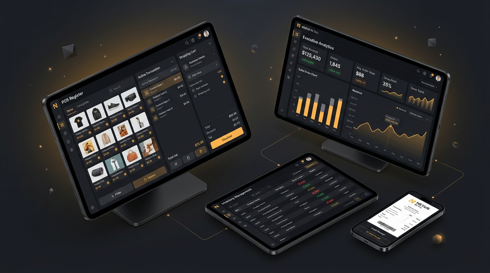
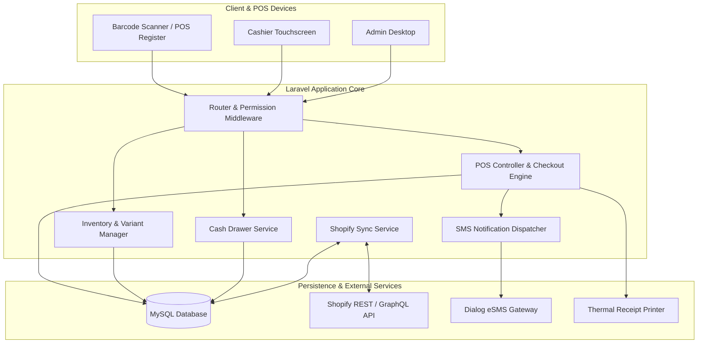

# Factory Outlet POS — Enterprise Retail & Multi-Channel Inventory System



A high-performance, enterprise-grade Point of Sale (POS) and Retail Management System engineered with Laravel 12, Tailwind CSS, Alpine.js, and MySQL. Designed for modern fashion outlets, apparel brands, and retail chains requiring lightning-fast in-store checkout, bi-directional Shopify inventory synchronization, multi-payment settlement, automated SMS receipts, and granular role-based access control.

---

## Key Capabilities

- **High-Throughput POS Terminal**: Optimized for touchscreens, physical barcode scanners, and keyboard workflows with sub-second response times and live search indexing.
- **Bi-Directional Shopify Synchronization**: Real-time webhook ingestion (`orders/create`, `inventory_levels/update`), automated inventory reconciliation, and collection-level sync.
- **Multi-Tender & Split Payments**: Native support for Cash (with quick change presets), Credit/Debit Cards, Split/Multi-Pay, Koko, Mintpay, Payzy, Bank Transfer, and Gift Cards.
- **Digital Receipts & SMS Dispatch**: Automated SMS bill delivery via Dialog eSMS gateway with tokenized, secure public web invoice views (`/b/{token}`).
- **Comprehensive Returns & Refunds**: Line-item returns with automated inventory restoration, refund tracking, and reason auditing.
- **Cash Drawer & Float Management**: Shift open/close reconciliation, expected vs. actual variance tracking, petty cash in/out logging, and audit snapshots.
- **Gift Card Lifecycle Engine**: Generation, bulk CSV import, balance tracking, POS redemption, and custom printable card templates.
- **Role-Based Access Control (RBAC)**: Fine-grained permission matrices across modules with last-admin deletion protection and active status enforcement.
- **Enterprise Reporting & Analytics**: Executive KPI dashboards, daily sales summaries, cashier performance metrics, and exportable PDF / Excel reports.

---

## System Modules

### 1. Point of Sale (POS) Terminal
- **Instant Product Search**: Search across SKU, barcode, title, and category with live dropdown filtering.
- **Variant Selector**: Seamless modal selection for multi-attribute items (sizes, colors, custom attributes).
- **Cart Management**: Real-time line-item quantity adjustments, unit price overrides, line-level and global discounts (percentage or flat rate), shipping charges, and order notes.
- **Customer Association**: Fast customer search and inline new customer registration without leaving the cart workflow.
- **Idempotent Checkout**: Double-submit prevention and database transactions ensuring zero duplicate sales or stock anomalies.
- **Silent Thermal Printing**: Automatic background receipt printing via dedicated iframe workflows.

### 2. Product & Inventory Management
- **Dual-Source Architecture**: Distinct tracking for local in-store items and Shopify-synced catalog items.
- **Multi-Variant Structure**: Granular stock, price, SKU, and barcode management per variant.
- **Stock Threshold Alerts**: Automated indicators and badges for low-stock and out-of-stock items.
- **Bulk Organization**: Dynamic category assignment, collection filtering, and sorting by stock level, price, and update timestamp.

### 3. Shopify Integration Engine
- **Automated Webhooks**: Instant stock updates and sales decrement listeners.
- **Selective Sync**: Sync individual products, collections, categories, or entire catalogs on demand.
- **Sync Status Monitoring**: Real-time status indicators in the navigation header with background queue processing.

### 4. Sales History & Order Audit
- **Comprehensive Filtering**: Query transactions by date range, invoice number, customer ID, cashier, and payment method.
- **Transaction Drilldown**: Detailed invoice modal, thermal receipt reprinting, and SMS delivery status review.
- **Sales Void & Deletion**: Administrative sale deletion with automatic stock restoration.

### 5. Returns & Refunds
- **Itemized Return Workflow**: Select specific items and quantities from original invoices for return.
- **Restocking Automation**: Instant inventory replenishment upon return approval.
- **Multi-Method Refunds**: Issue refunds via original payment method, cash, or store credit / gift card.

### 6. Cash Drawer Management
- **Session Lifecycle**: Open shift float declaration, continuous transaction monitoring, and close shift reconciliation.
- **Discrepancy Reporting**: Automatic calculation of overages and shortages.
- **Petty Cash Operations**: Log cash-in and cash-out transactions with categorized reason codes.

### 7. Gift Card Engine
- **Card Issuance**: Generate unique alphanumeric card codes with custom monetary values.
- **Bulk Ingestion**: Import pre-generated gift cards via CSV templates.
- **POS Redemption**: Real-time barcode scanning or manual code lookup with partial balance deduction.

### 8. Reporting & Analytics Suite
- **Executive Dashboard**: Gross revenue, net profit, total orders, average transaction value, and low-stock counters.
- **Periodic Reports**: Daily, weekly, monthly, and custom date-range sales and revenue reports.
- **Export Capabilities**: Structured exports in PDF format (via Dompdf) and spreadsheet-ready Excel formats.

### 9. Staff & Permission Management
- **Role Assignment**: Granular permission toggles for POS, Sales Log, Products, Returns, Cash Drawer, Reports, Gift Cards, and Settings.
- **Security Safeguards**: Immediate session invalidation for inactive staff and safeguards preventing deletion of the primary administrator.

---

## Technology Stack

| Layer | Technologies |
| :--- | :--- |
| **Backend Framework** | Laravel 12 (PHP 8.2+) |
| **Frontend Architecture** | Blade Templates, Tailwind CSS, Alpine.js, Vanilla JavaScript |
| **Typography & Icons** | Hanken Grotesk, Inter, FontAwesome 6 |
| **Database & ORM** | MySQL 8.0+ / MariaDB, Eloquent ORM |
| **Build System** | Vite, PostCSS, Tailwind CSS JIT |
| **PDF Generation** | Dompdf |
| **External APIs** | Shopify REST & GraphQL Admin API, Dialog eSMS API |

---

## Architecture and Data Flow



---

## Prerequisites

Ensure the server environment meets the following specifications:

- **PHP**: >= 8.2 with extensions: `bcmath`, `ctype`, `curl`, `dom`, `fileinfo`, `gd` or `imagick`, `json`, `mbstring`, `openssl`, `pcre`, `pdo_mysql`, `tokenizer`, `xml`
- **Composer**: >= 2.x
- **Node.js**: >= 18.x and **NPM**: >= 9.x
- **Database**: MySQL 8.0+ or MariaDB 10.5+
- **Web Server**: Nginx, Apache (with `mod_rewrite`), or Laravel Sail / Octane

---

## Installation & Setup

### 1. Clone Repository
```bash
git clone https://github.com/your-organization/clothing-store-pos.git
cd clothing-store-pos
```

### 2. Install Dependencies
```bash
# Install PHP dependencies
composer install --no-interaction --prefer-dist --optimize-autoloader

# Install Node dependencies
npm install
```

### 3. Configure Environment
```bash
# Create environment file
cp .env.example .env

# Generate application encryption key
php artisan key:generate
```

Update your `.env` configuration with your database and service credentials:

```ini
APP_NAME="Clothing Store POS"
APP_ENV=production
APP_DEBUG=false
APP_URL=https://pos.yourstore.com

DB_CONNECTION=mysql
DB_HOST=127.0.0.1
DB_PORT=3306
DB_DATABASE=clothing_pos
DB_USERNAME=pos_user
DB_PASSWORD=your_secure_password

QUEUE_CONNECTION=database
SESSION_DRIVER=database
CACHE_STORE=database

# Shopify Configuration (Optional)
SHOPIFY_ENABLED=true
SHOPIFY_SHOP=your-store.myshopify.com
SHOPIFY_TOKEN=shpat_xxxxxxxxxxxxxxxxxxxxxxxx
SHOPIFY_API_KEY=xxxxxxxxxxxxxxxxxxxxxxxx
SHOPIFY_API_SECRET=xxxxxxxxxxxxxxxxxxxxxxxx

# SMS Configuration (Dialog eSMS)
SMS_DRIVER=dialog
SMS_GATEWAY_URL=https://e-sms.dialog.lk/api/v1/message-via-url/create/url-campaign
SMS_BALANCE_URL=https://e-sms.dialog.lk/api/v1/message-via-url/check/balance
SMS_GATEWAY_KEY=your_esms_key
SMS_SENDER_MASK=YOURSTORE
SMS_MAX_SEGMENTS=2
```

### 4. Database Setup & Seed Data
```bash
# Run database migrations
php artisan migrate --force

# Seed base roles and initial admin account
php artisan db:seed
```

Default administrative credentials seeded by `DatabaseSeeder`:
- **Email**: `kasun@shop.com`
- **Password**: `password`

*(Change default credentials immediately upon first login under Staff / Profile settings.)*

### 5. Compile Frontend Assets & Link Storage
```bash
# Compile production frontend bundle
npm run build

# Create symbolic link for public storage
php artisan storage:link
```

### 6. Start Development Server
To run the full stack locally with hot reloading and queue listening:
```bash
composer dev
```
Or run services individually:
```bash
php artisan serve
npm run dev
php artisan queue:listen
```

---

## Production Deployment & Daemon Setup

### 1. Optimize Caching
```bash
php artisan config:cache
php artisan route:cache
php artisan view:cache
```

### 2. Queue Worker (Supervisor Configuration)
Create `/etc/supervisor/conf.d/clothing-pos-worker.conf`:

```ini
[program:clothing-pos-worker]
process_name=%(program_name)s_%(process_num)02d
command=php /var/www/clothing-store-pos/artisan queue:work database --sleep=3 --tries=3 --max-time=3600
autostart=true
autorestart=true
stopasgroup=true
killasgroup=true
user=www-data
numprocs=2
redirect_stderr=true
stdout_logfile=/var/www/clothing-store-pos/storage/logs/worker.log
stopwaitsecs=3600
```

### 3. Task Scheduling (Cron)
Add the Laravel scheduler to your server crontab (`crontab -e`):

```cron
* * * * * cd /var/www/clothing-store-pos && php artisan schedule:run >> /dev/null 2>&1
```

---

## Shopify Webhook Configuration

In your Shopify Partner / Store Admin under **Settings > Notifications > Webhooks**, configure the following endpoints:

| Topic | Format | Endpoint URL | API Version |
| :--- | :--- | :--- | :--- |
| `orders/create` | JSON | `https://pos.yourstore.com/shopify/webhook/orders-create` | Latest (2024-10+) |
| `inventory_levels/update` | JSON | `https://pos.yourstore.com/shopify/webhook/inventory-update` | Latest (2024-10+) |

Ensure `SHOPIFY_API_SECRET` in your `.env` matches the webhook verification secret.

---

## Directory Structure

```
clothing-store-pos/
├── app/
│   ├── Http/
│   │   ├── Controllers/        # POS, Sales, Products, Returns, Drawer, Reports, Shopify
│   │   ├── Middleware/         # AdminMiddleware, EnsureUserIsActive, PermissionMiddleware
│   │   └── Requests/           # StoreStaffRequest, UpdateStaffRequest
│   ├── Models/                 # Product, Variant, Sale, SaleItem, Return, CashDrawer, Customer
│   ├── Services/               # PermissionService, ShopifyService, SmsService
│   └── Traits/                 # HasPermissions
├── database/
│   ├── migrations/             # Schema definitions and indexing migrations
│   └── seeders/                # Base administrative and sample seeders
├── docs/
│   └── images/                 # Showcase and documentation assets
├── public/                     # Compiled assets, favicon, upload storage
├── resources/
│   ├── css/                    # Tailwind CSS configuration and stylesheets
│   ├── js/                     # POS calculations, AJAX listeners, Alpine components
│   └── views/                  # Blade templates (POS, Products, Reports, Settings, Drawer)
├── routes/
│   ├── auth.php                # Authentication routes
│   └── web.php                 # POS, Admin, API, and Webhook routes
└── tests/                      # Feature and Unit tests
```

---

## Custom Mockup Generation Guide (For Custom Screenshots)

If you wish to re-generate the product banner mockup or upload your exact system screenshots to an AI generator (such as Midjourney v6, ChatGPT DALL-E, or Stable Diffusion / FLUX), use the structured prompt below:

### AI Image Generator Prompt

```text
A high-resolution, professional product showcase banner for a modern enterprise Point of Sale (POS) and retail management software. Clean 3D perspective / isometric layout displaying multiple dark-mode UI screens floating over a dark obsidian charcoal background (#0E1013) with subtle ambient golden-amber illumination (#F5A623). 

Key screens visible in the multi-device arrangement:
1. Main widescreen desktop terminal: POS Billing screen showing an apparel catalog grid with product cards, category pills, stock badges, and a full-height shopping cart panel with itemized totals and payment buttons.
2. Second desktop/tablet monitor: Executive Analytics Dashboard displaying daily revenue charts, sales trend lines, and KPI cards with bold typography.
3. Centered tablet interface: Inventory Management table showing product variants, SKU numbers, category tags, and stock status pills (In Stock, Low Stock).
4. Angled smartphone display: Clean digital SMS receipt invoice view showing a verified store logo, order number, line items, barcode, and total paid badge.

Aesthetic: Ultra-premium SaaS product marketing banner, sharp typography, minimalist borders, refined glassmorphism, studio product lighting, 8k resolution, crisp UI rendering, no clutter, no distorted text.
```

### Steps for Using with Custom UI Screenshots in Graphic Editors:
1. Capture clean 1920x1080 screenshots of your POS terminal (`/pos`), Dashboard (`/dashboard`), Product Inventory (`/products`), and public mobile bill (`/b/{token}`).
2. Open a Figma or Photoshop perspective mockup template (e.g., "Dark Minimalist Multi-Device Mockup").
3. Paste each screenshot into the respective device smart object / frame.
4. Export as a 16:9 banner to `docs/images/banner.jpg`.

---

## Security & Reliability Standards

- **Transactions & Rollbacks**: All sales, returns, and inventory adjustments execute inside atomic database transactions (`DB::transaction()`).
- **Role Isolation**: Strict middleware guards on administrative and cashier routes.
- **Input Sanitization**: Form requests and parameterized Eloquent queries protecting against SQL injection and XSS.
- **Tokenized Invoices**: Public bill links utilize unguessable random tokens with configurable time-to-live (`SMS_BILL_LINK_TTL_DAYS`).

---

## License

This software is proprietary and confidential. Unauthorized copying, modification, distribution, or deployment is strictly prohibited.